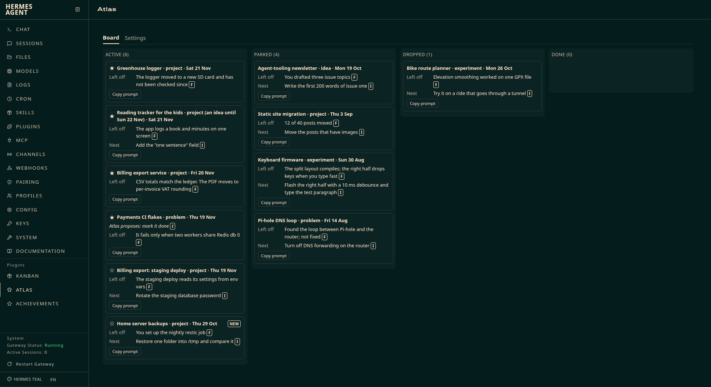
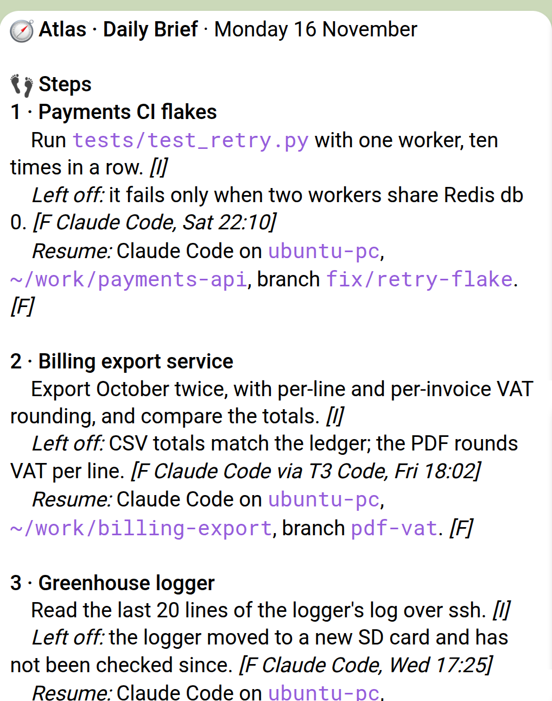

# Atlas

Atlas is a Hermes plugin that keeps track of what you are working on across your AI coding tools. It reads the conversations Claude Code, Codex, Devin and Hermes keep on your machine, and the ChatGPT and claude.ai exports you give it, groups them into Pursuits with where you left off and the next Step, and sends you a Daily Brief in Telegram each morning with up to three Steps to pick up. Everything it keeps is a folder of plain Markdown files on your own disk.





```bash
hermes plugins install atlas --enable
```

Atlas needs Hermes v0.23.0 or later on Linux, with a Telegram home channel. **[Read the user guide](atlas/README.md)** for setup, daily use, settings, cost and exactly what Atlas reads, writes and sends.

MIT licence, see [LICENSE](LICENSE). Changes are in [CHANGELOG.md](CHANGELOG.md).
