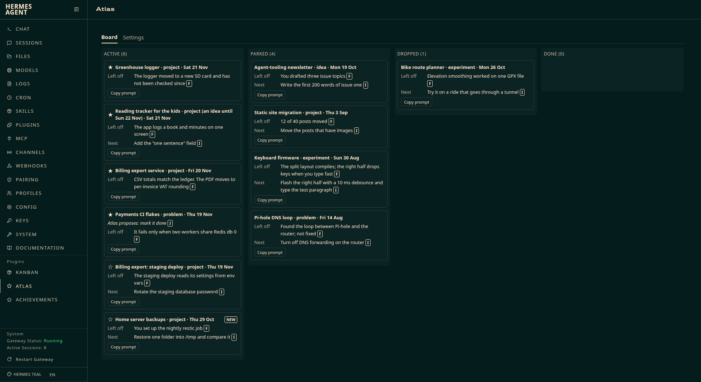
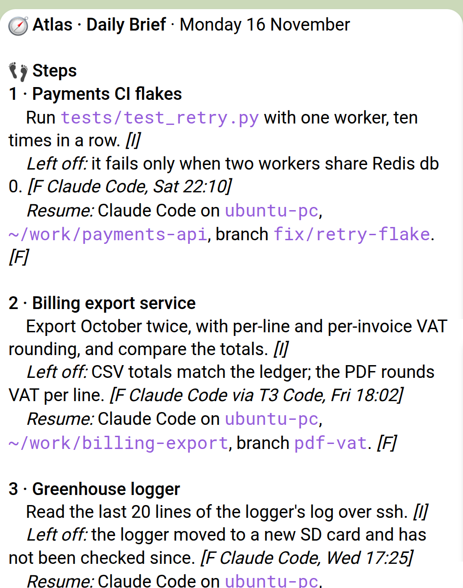

# Atlas

**Keeps track of what you are working on across your AI coding tools, and tells you each morning what to pick up next.**

[](https://github.com/zhaidarbek/hermes-atlas/actions/workflows/ci.yml) [](../LICENSE) [](https://github.com/NousResearch/hermes-agent)

Atlas is a Hermes plugin. It reads the conversations that Claude Code, Codex, Devin and Hermes already keep on your machine, including the ones you run through T3 Code, and the ChatGPT and claude.ai exports you give it. It groups them into **Pursuits**, the projects, problems, ideas and experiments you started, and keeps each one's state in a folder of plain Markdown files: where you left off, what you decided, and the next Step. Every morning it sends a **Daily Brief** to your Telegram chat with Hermes, with up to three Steps from the Pursuits you starred. You answer in plain words, and Atlas keeps the record current. Your agents can read that record too, so any of them can pick up where another stopped.





```bash
hermes plugins install atlas --enable
hermes atlas setup
hermes atlas backfill
```

**Contents:** [Requirements and install](#requirements-and-install) · [First run](#first-run) · [Your day with Atlas](#your-day-with-atlas) · [Where your Sessions come from](#where-your-sessions-come-from) · [The record folder](#the-record-folder) · [The Board tab](#the-board-tab) · [Agent tools](#agent-tools) · [Settings](#settings) · [Commands and surfaces](#commands-and-surfaces) · [Privacy: what Atlas does on your machine](#privacy-what-atlas-does-on-your-machine) · [Cost](#cost) · [Limits and known issues](#limits-and-known-issues) · [Troubleshooting](#troubleshooting) · [Uninstall](#uninstall) · [How it was tested](#how-it-was-tested) · [Licence and changelog](#licence-and-changelog)

A few words Atlas uses:

- **Session**: one conversation with an AI tool, such as one Claude Code run in one folder.
- **Harness**: a tool whose Sessions Atlas reads: Claude Code, Codex, Devin, Hermes, ChatGPT, claude.ai.
- **Pursuit**: something you started and might come back to. Each has a Kind (project, problem, idea or experiment), a Status (active, parked, dropped or done) and an Area of your life, such as work or home.
- **Focus**: the Pursuits you starred. The Daily Brief draws its Steps from them.
- **Step**: the one next action Atlas suggests for a Pursuit.
- **`[F]` and `[I]`**: every line Atlas writes is marked as a Fact, read from your Sessions, or an Inference, its own judgment. A Fact cites its source the first time, such as `[F Claude Code, Sat 22:10]`.

## Requirements and install

- Hermes v0.23.0 or later, on Linux, with Python 3.11 or later.
- A Telegram bot paired in Hermes, and a Telegram home channel: send `/sethome` to your bot in the chat where you want the brief.
- The Hermes gateway running. It runs Hermes's cron jobs, which run Atlas's tick, and it hands Atlas your Telegram replies.
- For the Board and Settings tabs, the Hermes dashboard (`hermes dashboard`).
- No API key and no account of its own. Atlas uses the model your Hermes is configured with.

Install from the Hermes plugin catalog:

```bash
hermes plugins install atlas --enable
```

Hermes asks before it installs Atlas's three Python dependencies, `zstandard`, `mcp` and `pyyaml`. In a script or over SSH without a terminal, add `--yes-deps` to answer that question yourself. Without `--enable`, Hermes asks whether to enable the plugin; you can enable it later with `hermes plugins enable atlas`.

To install from the repository instead of the catalog, name the folder that holds the plugin after `#`:

```bash
hermes plugins install zhaidarbek/hermes-atlas#atlas --enable
```

To check a copy before you install it, run `hermes plugins validate /path/to/hermes-atlas/atlas --install-deps`. The command takes the plugin's folder, not its name.

## First run

### `hermes atlas setup`

Setup creates the record folder (`~/atlas` unless you set `record_dir`, see [Settings](#settings)), finds the Harness stores on this machine, checks your Telegram home channel and schedules the tick. It prints what it found:

```
Atlas 0.1 on home-pc, inside Hermes
Record:   ~/atlas   (plain files, readable without Hermes or Atlas)
Channel:  Telegram, through the Hermes gateway
Model:    the one your Hermes uses, for every Area; secrets masked before it reads

Found on this machine
  Claude Code  ~/.claude/projects     212 Sessions since 3 Jun
  Codex        ~/.codex/sessions      140 Sessions since 9 Jul
Interfaces    T3 Code: its Sessions count once, under their Harness
Not found     Devin, Hermes.
              Harnesses in the browser, such as ChatGPT and claude.ai.
              Add them in Atlas's settings.
Exclusions    none named
Machines      this one only. Sessions on your other machines are not collected.
```

It then prints the commands that give your agents Atlas's tools (`claude mcp add atlas -- hermes atlas mcp` and `codex mcp add atlas -- hermes atlas mcp`, for the Harnesses it found), and a list headed "What Atlas does on this machine": the folders it reads and never writes, the folder it writes, the cron job, and what it does with a file you edit by hand.

Setup creates:

- the record folder, mode 0700, with `settings.md`, `profile.md` and a `README.md` that explains its layout;
- the script `$HERMES_HOME/scripts/atlas_tick.sh`;
- the Hermes cron job `atlas-tick`, which runs `hermes atlas tick --quiet` every 10 minutes.

Run setup again at any time. It keeps your settings and finds the cron job already there. On a first run:

- When it finds no Harness store, it lists them all under "Not found" and Atlas collects nothing.
- When Hermes has no Telegram home channel, the `Channel:` line says so and tells you to send `/sethome` and run setup again. No brief is sent until then.
- When Hermes refuses to create the cron job, setup prints the `hermes cron create` command for you to run.
- When the record folder is on a network mount, setup stops and asks for a folder on this machine's own disk.

From the first tick after setup, Atlas copies new and grown Sessions into the record.

### `hermes atlas backfill`

Backfill reads every Session already on the machine, copies it into the record and asks your model to group the Sessions into Pursuits. It prints a summary:

```
Read 352 Sessions. 41 subagent conversations were folded into the Sessions that started them.
96 Sessions came through T3 Code. Each counts once, under Claude Code or Codex.

Pursuits         9
  active         6   touched since 15 Oct
  parked         3   quiet for more than a month
Not a Pursuit   38 one-off Sessions, kept as Evidence
Journal         88 days, 3 Jun to 15 Nov
Board          http://127.0.0.1:9119/atlas
```

A Pursuit touched in the last month starts active, an older one starts parked, and none starts done or dropped: only you end a Pursuit.

Backfill costs model calls: one for each Session (it sends up to about 11,000 characters of the transcript, with its folder, branch and title), more calls to group the Sessions folder by folder, one for each Session on each day of the Journal, and one for your first Profile. On a long history it can take several minutes. If it stops, run it again: it keeps the answers it already has and goes on from there. If no model answers, it prints "No model answered, so no Pursuits yet. Set auxiliary.atlas_backfill in Hermes's config and run backfill again."

Then open the Board (`hermes dashboard`, then http://127.0.0.1:9119/atlas) and star the Pursuits you want in Focus.

## Your day with Atlas

### The Daily Brief

At 07:30 local time (you can change it in Settings), the tick sends the Daily Brief to your Telegram home chat. If the machine was off at 07:30, the brief comes when the tick next runs that day. A brief after the first one looks like this:

```
Atlas · Daily Brief · Tuesday 17 November

YESTERDAY'S STEPS
    ✓ Payments CI flakes: done, you said so. [F]
    ✓ Billing export service: done. Seen in Claude Code via T3 Code, Mon 21:40:
      per-invoice rounding matches the ledger. [F]
    · Greenhouse logger: no sign of it in your Sessions. [F] It is still the next Step. [I]

STEPS
1 · Greenhouse logger        Read the last 20 lines of the logger's log over ssh. [I]
    Left off: the logger moved to a new SD card and has not been checked since. [F Claude Code, Wed 17:25]
    Resume: Claude Code on home-pc, ~/home/greenhouse/firmware. [F]
2 · Billing export service   Switch the PDF export to per-invoice rounding and rerun October. [I]
    Left off: CSV totals match the ledger; the PDF rounds VAT per line. [F Claude Code via T3 Code, Mon 21:40]
    Resume: Claude Code on home-pc, ~/work/billing-export, branch pdf-vat. [F]

    Reply "1 prompt" or "2 prompt" for a paste-in prompt.

NEEDS A DECISION
    Bike route planner · experiment · quiet 22 days [F]
    Last: elevation smoothing worked on one GPX file in Codex on Mon 26 Oct. [F]
    Continue, park, or drop?
```

Line by line:

- **YESTERDAY'S STEPS** says what became of the last brief's Steps. A Step is done when you said so, or when Atlas saw it done in a Session, and then it names that Session. A Step with no sign stays open and is offered once more; offered twice with no sign, it is skipped. After a day with no brief the heading names the day it follows up, such as "(from Friday)". Your very first brief says "None. This is your first brief." instead.
- **STEPS** holds up to three Steps, one per Pursuit, from your Focus. Each has the Step, a **Left off** line with where you stopped and a **Resume** line with the Harness, the machine, the folder and the git branch. For a Step last worked in a web chat, the Resume line names the conversation's title and day instead. Until you star a Pursuit, the heading reads "STEPS (no Focus picked yet)" and the Steps come from your most recent work.
- **NEEDS A DECISION** asks about at most one Pursuit a day: an active one outside Focus that has been quiet for 14 days or more, the quietest first. Atlas asks about a Pursuit at most twice. If the second ask also goes unanswered, Atlas parks that Pursuit by itself when it composes the next brief, and the Board marks the card as changed.
- When yesterday's Step looks as if it finished the Pursuit, the follow-up adds: This Pursuit looks finished. Reply "close it" to mark it done.

Atlas never starts a conversation except for two messages: this brief each morning and the weekly Review.

### How messages look in Telegram

The sample above is the plain text Atlas keeps in the record. In Telegram the Daily Brief and the weekly Review go out as Telegram HTML, and answers go out as Markdown that Hermes turns into Telegram's markup (`atlas/telegram.py`). Both use bold, italic and code. Each heading is bold, in sentence case, with one emoji, such as 👣 **Steps** or 📌 **Decided**. A Step's number and Pursuit name are bold, with the Step on the next line, and paths, folders, branches and URLs are in code. Text that comes from your Sessions is escaped, so it cannot add formatting, links or hidden text. A known limit: Markdown cannot show a `*` or a backtick as text, so in an answer a `*` or backtick taken from a Session shows as a look-alike character (∗ or ˋ). A message too long for one Telegram message is sent without formatting.

### Replying in Telegram

Your Telegram chat with Hermes is shared with Hermes's own agent, so Atlas only takes the messages meant for it. It looks only at messages from you (the user who ran `/sethome`) in that chat, and it takes:

- a message that starts with the word **atlas**, such as "atlas, what have I neglected?";
- a **reply** to a Daily Brief or to the weekly Review;
- any message sent within **10 minutes** of the last one Atlas took, so you need the word only once per conversation;
- **`/atlas <words>`**, from Telegram or from the Hermes terminal.

If you give Atlas a chat or topic of its own in Settings, every message you type there is Atlas's. A message Atlas cannot read goes on to Hermes's agent as if Atlas were not there. An answer that takes longer than 25 seconds arrives as a separate message after "Looking, I'll send it here."

Replies to the brief, where the number is the Step's number in the brief you reply to (or the latest brief):

| You write | What happens |
|---|---|
| `1 done` or `1 done, 10/10 pass` | Marks Step 1 done; words after it are kept as the detail. |
| `skip 2` or `2 skip, not today` | Skips Step 2. |
| `1 prompt` | Sends a paste-in prompt for Step 1 as its own message, to paste into any Harness. |
| `3 remind me friday` | Holds Step 3 until Friday: it is not offered before then and comes first that day. Any weekday works. |
| `continue`, `park`, `drop` | Answers the brief's decision question. |
| `remind me monday` | Holds the decision question until Monday. |
| `park the newsletter`, `drop bike planner`, `continue backups` | Changes the Status of the Pursuit those words name. |
| `close it` | Marks done the Pursuit the brief proposed to close. |

You can put several in one message: "1 done. park the newsletter" or "1 done, 2 skip". Atlas answers each line, such as "Payments CI flakes: Step done." When your words fit more than one Pursuit, it asks which and changes nothing.

Other things you can tell Atlas, starting with "atlas" or inside the 10 minutes:

- **Pause**: "pause" (a week), "pause until sunday morning", "pause for 3 days", "pause until 30 nov". "I'm back" ends it early. A Pause stops the Daily Brief and the clocks that count quiet days; the tick still collects and files your Sessions.
- **Correct the filing**: "merge the two greenhouse ones", "split the staging deploy chores out of Billing export service", "put the greenhouse logger in a new Area, home". The model reads these, and only does the kind of change your words ask for.
- **Correct your Profile**: "profile: I skip greenhouse steps in the morning, evenings are fine".
- **Forget a Session**: "forget the Codex Session from 19 Nov 14:02". Atlas lists what it will remove and waits for you to reply with the one word `forget`, within an hour. Any other reply cancels it. See [Forget](#forget).
- **apply**: when you edit `profile.md` by hand, or an agent asked for a change Atlas could not check, Atlas tells you the whole change and waits for `apply`.

### Asking questions

- "where did I leave off on the keyboard firmware?" answers with the Pursuit's Resume Note: where, left off, decided, the open question, the next Step and the Sessions to reopen. Reply `prompt` for a paste-in prompt.
- "what have I neglected?" lists the Pursuits that are Neglected and what you parked or dropped lately.
- "find the conversation where I got the GPX elevation smoothing working" finds the Session, with its Harness, time, folder and Pursuit, even in a dropped Pursuit.
- "how long did I work this week, by Area?" (or "last week") gives your Active Time per Area and Pursuit.

Atlas never contacts anyone but you. "atlas, send Dana the status" is refused, with the status for you to forward yourself.

### The weekly Review

Once a week, on Sunday at 18:00 unless you change it in Settings, Atlas sends the weekly Review to the same chat. It leaves out any section with nothing to say:

- **FINISHED**: the Pursuits you ended and the Steps done, by your word and seen in Sessions.
- **DECIDED**: the decisions recorded that week.
- **CHANGED**: your parks, drops, continues and Focus changes.
- **WHAT I DID ON MY OWN**: Pursuits Atlas created or changed, Sessions it filed by your rules, Profile entries it added.
- **FOCUS**: proposals to add a Pursuit to Focus when a slot freed up, or to remove one after three skipped Steps in a row.
- **ENDINGS** and **REOPENING**: proposals to close a Pursuit, or to reopen a done or dropped one you worked on again.
- **PARKED**: at most one parked Pursuit quiet for 90 days or more, with where you left off.
- **WAITING FOR "apply"**: hand edits and agents' changes that wait for you.
- Exports Atlas could not read, and a new brief time when your working days start an hour or more away from it.

Reply to the Review (or write to Atlas after it, when no brief came since) with `add <name>`, `remove <name>`, `leave it`, `continue`, `keep parked`, `drop`, `close it`, `reopen it`, `move it` (move the brief to the proposed time) or `keep it`. When a word fits two of its questions, Atlas asks which. The Review only proposes: nothing joins or leaves Focus, ends or reopens until you reply. It is sent at most once a week and not while Atlas is paused.

## Where your Sessions come from

Atlas finds these stores by itself and reads them without writing:

| Harness | Where Atlas looks | Override |
|---|---|---|
| Claude Code | `~/.claude/projects` | `CLAUDE_CONFIG_DIR` |
| Codex | `~/.codex/sessions` and `~/.codex/archived_sessions` | `CODEX_HOME` |
| Devin | `~/.local/share/devin/cli/sessions.db` | none |
| Hermes | `~/.hermes/state.db` | `HERMES_HOME` |
| T3 Code | `~/.t3/userdata/statev2.sqlite` | `T3CODE_HOME` |

T3 Code is an Interface that runs the other Harnesses: Atlas reads it to learn which Session each T3 Code thread ran, and counts that Session once, under its Harness. Subagent conversations are folded into the Session that started them. You can add more folders for Claude Code, Codex, Devin or Hermes in Settings, and leave folders out with an exclusion. Atlas reads only the machine it is installed on.

**ChatGPT and claude.ai.** Atlas cannot find web chats on disk. Add them in the Settings tab, request a data export from each service, and drop the `.zip` it sends you into `~/atlas/inbox/`. Each tick then:

- reads up to 20 export files and puts up to 500 conversations into the record; a larger export goes on over the next ticks;
- reads a file only once it has not changed for a minute, and never one that is a link;
- reads only the conversation files inside, in memory, never extracts the archive and never opens `group_chats.json`;
- refuses an archive larger than 2 GiB or with more than 100,000 entries, or whose conversation files would take more than about 1 GiB of memory;
- deletes the zip from the inbox once every conversation in it is in the record. A file it cannot read stays in the inbox, and the Settings tab and the Review say so.

A late export can add Sessions to days the Journal already has. Atlas then writes that day again and adds a "Corrected" line.

## The record folder

Everything Atlas keeps is in one folder, `~/atlas` by default, as plain files you can read with Hermes stopped:

```
~/atlas/
  README.md        how the folder is laid out
  settings.md      your settings
  profile.md       what Atlas has learned about how you work
  pauses.md        your Pauses
  forgotten.md     when you forgot a Session, and a hash of its id
  pursuits/        one Markdown file per Pursuit: Resume Note, Steps, History
  journal/         one file per day, such as 2026-11-16.md: Active Time, worked on, decided, finished
  briefs/          each Daily Brief as sent
  reviews/         each weekly Review as sent
  notes/           your words to Atlas and its answers, agents' Notes, hand edits
  evidence/        each Session: a readable transcript, a summary card, and the raw copy
  inbox/           drop ChatGPT and claude.ai exports here
  .atlas/          Atlas's own state, cache and search index
```

**Active Time** in the Journal is time you were engaged: a stretch runs while your own messages are less than 15 minutes apart (the gap is a setting), an agent working alone does not count, and parallel Sessions count once.

**Hand edits.** If you edit a record file by hand, Atlas puts its own version back on the next run and keeps your edit, with a diff, as a Note. For `profile.md` it then offers to make your change: reply `apply`. Correct things in Telegram instead; that is what Atlas reads. A file-sync tool that rewrites the record looks like a hand edit.

### Forget

Forget removes a Session for good: its raw copy, transcript and summary card, the cached model answers that read it, its rows in the search index, every Pursuit line, Step, History line, Journal line and Profile entry that cites it, and a Pursuit made from that Session alone. Atlas keeps the time of the Forget and a hash of the Session's id in `forgotten.md`, so it never collects that Session again. Forget does not remove the Session from the Harness's own store, which Atlas never writes: delete it there if a secret must go. It does not change a Daily Brief already sent, and Telegram keeps what was delivered.

## The Board tab

Run `hermes dashboard` and open the Atlas tab, at http://127.0.0.1:9119/atlas by default. It has two inner tabs, Board and Settings.

The Board shows your Pursuits in one column per Status: active, parked, dropped and done. Each card shows the Kind, the last day worked, where you left off and the next Step. On the Board you can:

- click the star to put an active Pursuit in Focus or take it out (past five, the Board shows how many are in Focus);
- drag a card to another column to change its Status;
- copy the paste-in prompt with **Copy prompt**;
- open the masked transcript of a Session.

A card Atlas created or changed by itself is marked new or changed until you have seen it, and a card carries any proposal Atlas has for it. Merges, splits and Areas are changed in Telegram, not on the Board.

## Agent tools

Atlas gives agents three tools:

- **`atlas_read`**: a Pursuit's Resume Note, or what the Journal holds for one day, across all Areas, with secrets masked. Never a transcript, a file or a forgotten Session.
- **`atlas_note`**: leave Atlas a Note, such as a decision. Agents may add Notes unasked.
- **`atlas_update`**: change a Pursuit's Resume Note, only when you told the agent to in that Session.

Agents in Hermes get them, with the `atlas` skill that says when to call them. For Claude Code and Codex, run the line setup printed:

```bash
claude mcp add atlas -- hermes atlas mcp
codex mcp add atlas -- hermes atlas mcp
```

`hermes atlas mcp` talks to the one Harness that starts it over stdin and stdout, and opens no network port. It takes at most 20 Notes and changes a minute.

What an agent can change: when you tell it, in a Session, something like "tell atlas the open question is settled: the card lasts about 3 years", Atlas finds that message in the Harness's own store and adds it to the Pursuit as one Decided line. When the message says outright that the Pursuit's only Open question is settled, it removes that question. It does this only for Claude Code and Codex, where it can tell which Session the call comes from. Any other change, or one from Devin or Hermes's agent, is kept as a Note and offered to you whole in Atlas's next answer; `apply` makes it. The rules are in [Privacy](#privacy-what-atlas-does-on-your-machine).

## Settings

Atlas keeps one setting in Hermes, `record_dir`, the folder for the record (default `~/atlas`). Set it with `plugins.entries.atlas.settings.record_dir` in Hermes's `config.yaml`, or set `ATLAS_RECORD` for one command.

Everything else is in the Settings tab, saved in the record's `settings.md`:

| Setting | Default | What it does |
|---|---|---|
| Web chats | none | Add ChatGPT or claude.ai, whose exports you drop in the inbox |
| Extra folders | none | Another folder to read for Claude Code, Codex, Devin or Hermes. A folder reached through a link is refused |
| Exclusions | none | Folders whose Sessions Atlas never collects, such as `~/clients` |
| Daily Brief time | 07:30 | When the brief is sent, in this machine's time zone |
| Weekly Review | Sunday 18:00 | The day and time of the Review |
| Active Time gap | 15 minutes | How far apart your messages can be and still count as one stretch of work, 1 to 120 |
| Atlas's own chat | none | A Telegram chat or topic, `telegram:<chat id>` or `telegram:<chat id>:<topic id>`, where every message you type is Atlas's |

Each kind of model call is a Hermes auxiliary task, so you can send it to another model, a cheaper or local one, in Hermes's auxiliary-model settings: `atlas_backfill`, `atlas_file`, `atlas_journal`, `atlas_converse` and `atlas_answer` (see the table below).

## Commands and surfaces

| Surface | Name | What it does in 0.1.0 |
|---|---|---|
| CLI command | `hermes atlas setup` | Creates the record, finds the Harness stores, checks the Telegram home channel, schedules the tick |
| CLI command | `hermes atlas backfill` | Copies every Session into the record, builds the Pursuits and writes the Journal |
| CLI command | `hermes atlas tick` | Collects new Sessions, imports the web-chat exports in the inbox, files the Sessions, writes the Journal, and sends the Daily Brief and the weekly Review when each is due |
| CLI command | `hermes atlas reindex` | Rebuilds the search index from the record |
| CLI command | `hermes atlas mcp` | Serves the three agent tools to the one Harness that starts it, over stdin and stdout, with no network port |
| CLI command | `hermes atlas status` | Not built yet. The command exits with an error |
| Cron job | `atlas-tick` | Runs `hermes atlas tick --quiet` every 10 minutes |
| Agent tools | `atlas_read`, `atlas_note`, `atlas_update` | Read a Pursuit's Resume Note or a Journal day, leave a Note, and change a Resume Note when you told the agent to in that Session |
| Gateway hooks | `pre_gateway_dispatch`, `post_gateway_admission` | Take your messages to Atlas in Telegram and answer them |
| Slash command | `/atlas` | Hands the words after it to Atlas, from Telegram or the Hermes terminal |
| Skill | `atlas` | Tells Hermes agents when to call the three agent tools |
| Auxiliary model task | `atlas_backfill` | Summarises and groups the Sessions during backfill, and writes the first Profile |
| Auxiliary model task | `atlas_file` | Files each new or grown Session on the tick |
| Auxiliary model task | `atlas_journal` | Writes each day's Journal lines and what that day adds to the Profile |
| Auxiliary model task | `atlas_converse` | Reads your corrections to filing and to your Profile |
| Auxiliary model task | `atlas_answer` | Picks the Session that answers "find the conversation where" |
| Messages out | `hermes send` | Sends the Daily Brief, the weekly Review and a late answer to your Telegram chat |
| Plugin setting | `record_dir` | Where the record lives |
| Dashboard tab | `/atlas` | The Board and Settings |
| Dashboard API | `GET /board` | The Board: your Pursuits in Status columns, with Focus stars and new and changed marks |
| Dashboard API | `PATCH /pursuits/{pursuit}` | Changes one Pursuit's Status or its Focus star |
| Dashboard API | `POST /seen` | Records which cards you have seen |
| Dashboard API | `GET /transcript/{evidence}` | The masked transcript of one Session, as plain text |
| Dashboard API | `GET /settings` | The Settings tab's view of `settings.md` |
| Dashboard API | `PATCH /settings` | Makes one settings change |

The dashboard API paths are relative to `/api/plugins/atlas`.

## Privacy: what Atlas does on your machine

Atlas reads your conversations, so read this before you install. Each point names the code that does it, under `atlas/` in this repository.

**What it reads**

- The Harness stores in [Where your Sessions come from](#where-your-sessions-come-from), and the folders you add in Settings, never writing them (`atlas/sources/_adapters.py`). It opens each SQLite store read-only. It never opens a store file that is a link, and skips a store folder that is itself a link, but reads through a Harness's default folder, or one named by an override variable, that is a link. It refuses a folder you add in Settings when any part of its path is a link.
- The export zips you drop in `inbox/`, with the limits above (`atlas/sources/_webchat.py`).
- Never a credential file, such as `~/.claude/.credentials.json`, `~/.codex/auth.json` or Hermes's `.env`.
- Its own process's `/proc/self/fd` and `/proc/self/maps`, to check which file SQLite opened. Hermes's install scanner reports these as `proc_access` cautions.
- `TZ`, `/etc/timezone` and `/etc/localtime` for the time zone, and `/proc/mounts` (or the `mount` command) to check that the record is on a local disk (`atlas/app.py`, `atlas/record/_txn.py`).
- From Hermes's `config.yaml`, only `plugins.entries.atlas.settings.record_dir`, in the dashboard backend (`atlas/board_api.py`).

**What it writes**

- The record folder, mode 0700 (`atlas/record/`). It holds a zstd-compressed copy of every Session transcript, byte for byte, under `evidence/`. A password or key you pasted into a conversation is in that copy. Atlas masks the secrets it detects (API keys, tokens, passwords, private keys, credentials in URLs) in every file it derives from the copies: transcripts, Pursuits, the Journal, Notes, briefs and the search index (`atlas/privacy.py`). Detection is best effort: a secret in a form it does not know stays unmasked. For claude.ai, the copy includes the text the export extracted from files you attached.
- This machine's host name, in `settings.md`, with each Session it copies and in each Pursuit's Where line. Backfill's last grouping call sends each draft Pursuit's Where line, host name included, to the model.
- `$HERMES_HOME/scripts/atlas_tick.sh`, and the Hermes cron job `atlas-tick` (`atlas/schedule.py`). Atlas starts no background process of its own.
- Outside the Session folders under `evidence/` and the exports in `inbox/`, it never changes or deletes a file in the record folder that it did not write. When it removes a Session's folder, it deletes every file in it.

**What it deletes**

- An export zip in `inbox/`, once every conversation in it is in the record, and only while the name still holds the file it read.
- What Forget removes (`atlas/forget.py`), after you confirm with the word `forget`.

**What it sends, and to whom**

- **To your model, unattended.** Every model call goes through Hermes's `ctx.llm` to the model your Hermes uses; if that is a cloud provider, the text leaves this machine (`atlas/librarian.py`). Secrets it detects are masked first. Backfill sends each Session's transcript. After backfill, every tick files up to 20 new or grown Sessions with one call each, sending the transcript, the Notes an agent wrote in it and the list of your Pursuits, whether or not you are at the machine. Every tick writes the Journal for each day that closed, one call per Session worked that day, and once a day sends your Profile with that day's Steps, Journal lines and Session times (never transcript text). When you ask Atlas to find a conversation, it sends your question and up to three matching transcripts; a correction in plain words sends your message with your Pursuits or your Profile.
- **To Telegram, unprompted.** The Daily Brief and the weekly Review go to your home chat (or Atlas's own chat) by running `hermes send` (`atlas/channel.py`). They hold Pursuit names, Steps, decisions and "left off" lines drawn from your Sessions, masked, and each Resume line names this machine's host name, the folder and the git branch, or for a web chat, the conversation's title and day. Answers to "where did I leave off" and the paste-in prompt carry the same. If your home chat is a group, everyone in it sees them. Text from your Sessions is escaped in the Telegram formatting, so it cannot add links or hidden text (`atlas/telegram.py`). If Hermes does not confirm delivery, a later tick sends the same message once more that day.
- **Nothing else.** Atlas stores no credentials, sends no telemetry, and its code opens no network connection. Everything that leaves the machine goes through Hermes.

**What it claims**

- In your Telegram chat with Hermes, the messages described in [Replying in Telegram](#replying-in-telegram), through two gateway hooks and `/atlas` (`atlas/channel.py`). A claimed message Atlas can read does not reach Hermes's agent. Atlas keeps your words and its answer as a Note.

**What runs unattended**

- The `atlas-tick` cron job, every 10 minutes: it collects, imports and deletes exports, files Sessions with model calls, writes the Journal and sends what is due.
- It parks a Pursuit by itself in one case: after the brief asked about it twice and the second ask went unanswered (`atlas/neglect.py`). It never marks a Pursuit done or dropped by itself. "continue" with the Pursuit's name makes it active again.
- A Pause stops the brief and the quiet-day clocks only; collecting, filing and model calls go on.

**What a model's answer can change**

The model's answers decide which Pursuit a Session is filed in and what Atlas writes about it (`atlas/filing.py`). The model reads the whole conversation, including text you did not write, such as a pasted web page or an agent's output, so text inside a conversation can influence the record and the next brief. The code bounds this:

- One filing rewrites the lines of at most one Pursuit, the one the Session is filed in. It can also list the Session under at most two other active Pursuits, which splits its Active Time with them; their lines do not change. It changes no settings and no Notes.
- Filing never marks a Pursuit done or dropped. Work on an ended Pursuit only proposes reopening it. A Session with no message you typed can start a new Pursuit but changes no line of an existing one.
- A filing adds at most two Decided lines, each kept only when its quote is found in a message you typed in that Session or in an agent's Note in it, and only with words that quote holds, apart from a few small ones such as "the" and "and".
- Each text is one line, masked, and at most 400 characters (80 for a name). A line counts as a Fact only when the model quotes at least 15 characters Atlas finds in that Session; Atlas marks a Step done only on such a quote.
- Atlas never runs text a model wrote as a command, and has no tool that acts outside its record. It refuses a message addressed to it that asks it to send, tell, email or message someone.

**Lets your agents read and write your record**

Any agent you give the tools to can read every Pursuit's Resume Note and every Journal day, across all Areas, masked (`atlas/agents.py`, `atlas/agentapi.py`). It cannot read a transcript, a file or a forgotten Session. It can add Notes unasked; when the tick files the Session a Note was written in, a decision in that Note can become a Decided line, under the limits above. Every text an agent sends is normalised, put on one line with quotes and brackets replaced, masked, and refused if it is longer than 400 characters or holds control or reordering characters, so it cannot pass for Atlas's own words (`atlas/untrusted.py`). An agent changes a Pursuit only when all of these hold (`atlas/told.py`):

- Atlas can tell which Session the call comes from. For Claude Code, `hermes atlas mcp` reads `~/.claude/sessions/<pid>.json` of the process that started it, and `/proc/<pid>/stat` to check that process wrote it. For Codex, it uses the thread id Codex puts on each call (`atlas/sources/_caller.py`). Devin and Hermes's own agent give no such proof.
- The agent passes one whole message you typed in that Session, among your newest five, that names Atlas ("tell atlas ..."), on one line and at most 400 characters. Atlas reads it from the Harness's own store. A message counts once.
- The Pursuit lists that Session.

The change comes from your message: it adds that message as one Decided line, and removes one Open question only when the message states outright that it is settled and it is the Pursuit's only Open question. Anything else is offered to you whole and waits for `"apply"`. Atlas keeps at most three such Notes from one Harness. A known limit: any process running as your user can start `hermes atlas mcp`, call itself Codex and name one of your Codex Sessions' thread ids, and so make, once, the change one of your messages to Atlas in that Session allows. Forget removes a Note an agent left in a Session Atlas tied it to. A Note Atlas could not tie to a Session, such as any Note from Devin or Hermes's agent, stays, and Forget does not remove it.

**Serves an API in the Hermes dashboard**

While the plugin is enabled, `hermes dashboard` serves Atlas's routes under `/api/plugins/atlas/` (`atlas/dashboard/plugin_api.py`). They read the Board, the settings and the masked transcript of any Session, and change a Pursuit's Status and Focus and Atlas's settings. Hermes's own dashboard sign-in guards them, as it guards Hermes's other routes; Atlas adds no check of its own. They listen wherever the dashboard listens: 127.0.0.1 by default.

**Runs commands**

Atlas runs the `hermes` CLI for `hermes send`, `hermes send -l`, `hermes cron list --all` and `hermes cron create` (`atlas/_hermes.py`), and `mount` where `/proc/mounts` is missing.

## Cost

Atlas costs whatever your model costs, and the tick spends it whether or not you are at the machine:

- **Backfill, once**: one call per Session, a few more to group them, one per Session per Journal day, one for the Profile. On a few hundred Sessions that is several hundred calls.
- **Every tick**: up to 20 filing calls every 10 minutes while new or grown Sessions wait, and nothing when none do.
- **Every day**: one call per Session worked on that day for its Journal, and one call for the Profile.
- **When you ask**: one call when you ask Atlas to find a conversation, and one when you correct the filing or your Profile in plain words (a split also sends the summary and last turn of each of that Pursuit's Sessions). The replies to the brief and the Review, Pause, Forget and the other questions make no model call.

Atlas keeps each model answer in `.atlas/cache` in the record, so the same input is never sent twice. To spend less, route `atlas_file` and `atlas_journal` to a cheaper or local model in Hermes's auxiliary-model settings.

## Limits and known issues

- `hermes atlas status` is registered and not built; it exits with an error.
- Atlas has been tested against real Hermes v0.23.0 with a scripted model and a stub `hermes send`. It has not yet been exercised with a real model's answers or live Telegram delivery.
- Linux only. Telegram is the only Channel.
- Atlas reads only the machine it is installed on. Sessions on your other machines are not collected.
- ChatGPT and claude.ai Sessions arrive only when you drop an export, so their work reaches the brief late.
- Hermes sends to the home channel's chat without its topic, so a home set in a forum topic gets the brief in the General topic. Run `/sethome` in a direct chat or the General topic, or give Atlas a topic of its own in Settings.
- If your Telegram chat is busy, Hermes skips Atlas's hook and Hermes's agent gets the message; it has Atlas's tools, so the reply is handled, only slower.
- Secret masking is best effort.

## Troubleshooting

- **No brief arrives.** Check that the gateway is running and that `hermes cron list` shows `atlas-tick`. Run setup again: the `Channel:` line says whether Hermes has a home channel. A paused Atlas sends no brief; write "I'm back".
- **"No model answered, so no Pursuits yet."** Hermes has no model for the `atlas_backfill` task. Set `auxiliary.atlas_backfill` in Hermes's config, or check your main model, and run backfill again.
- **Setup says the record is not on a local disk.** Point `plugins.entries.atlas.settings.record_dir` at a folder on this machine's own disk.
- **Atlas did not answer my message.** It takes only your messages in the home chat (or its own chat) that start with "atlas", reply to a brief or Review, come within 10 minutes of the last one it took, or use `/atlas`. Words it cannot read go to Hermes's agent.
- **An export stays in the inbox.** It is still being written, too large, or unreadable; the Settings tab says which. Atlas tries again once the file changes.
- **The Board is empty.** Run `hermes atlas backfill`. Before backfill the tick collects Sessions but builds no Pursuits.
- **"find the conversation where" misses a Session you know is there.** Run `hermes atlas reindex` to rebuild the search index from the record.

## Uninstall

1. Remove the cron job: run `hermes cron list`, then `hermes cron remove <id>` with the id it shows for `atlas-tick`.
2. Delete the tick script: `rm "${HERMES_HOME:-$HOME/.hermes}/scripts/atlas_tick.sh"`.
3. Disable and remove the plugin: `hermes plugins disable atlas`, then `hermes plugins remove atlas`.
4. If you added the MCP server: `claude mcp remove atlas` and `codex mcp remove atlas`.
5. The record folder stays until you delete it: `rm -rf ~/atlas` (or your `record_dir`). It holds copies of your conversations, so delete it if you no longer want them.

## How it was tested

The unit tests in `tests/` ship with this repository and run in CI. The full replay of a week of invented use, through the real Hermes v0.23.0 CLI with a scripted model and a stub `hermes send`, lives in the development repository.

## Licence and changelog

MIT, see [LICENSE](../LICENSE). Changes by version are in [CHANGELOG.md](../CHANGELOG.md).
