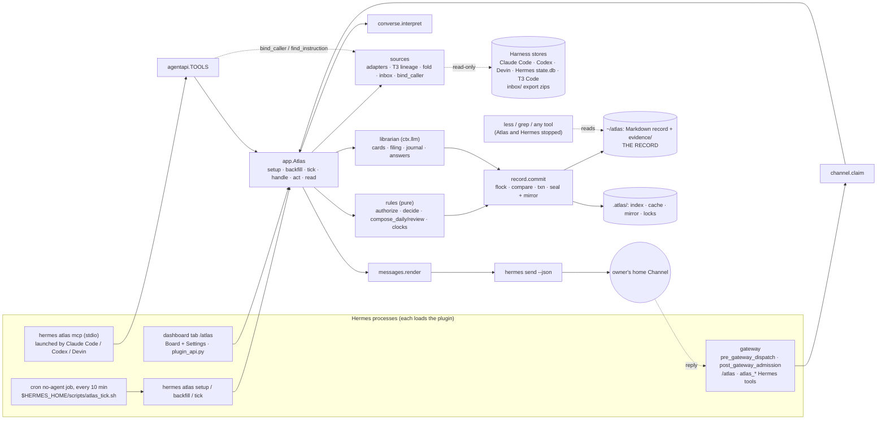

# Atlas v1 architecture (checkpoint draft)

Status: **accepted by the owner on 2026-11-08**, revised to the owner's answers of that day (brief, `D Qn`). Nothing here is implemented. Stage 6 turns this into a spec and tickets.

Companion files:
- [usage.md](usage.md): every tutorial scene walked through the calls, in full.
- [record-layout.md](record-layout.md): the on-disk record, with invented examples.
- [atlas/](../../atlas/): the `atlas` package, which began as the type sketch. Modules no ticket has filled yet still raise `NotImplementedError`.
- ADRs [0004](../adr/0004-markdown-files-are-the-record.md) to [0010](../adr/0010-codex-caller-bound-by-call-metadata.md).

Vocabulary is [GLOSSARY.md](../../GLOSSARY.md).

## Problem

Atlas is a Hermes catalog plugin that strangers install on one machine (ADR 0003). It reads that machine's Harness stores, keeps Pursuits current, and sends one Daily Brief a day and one Review a week. The shape is not obvious, because of what Hermes v0.23.0 actually offers and what the brief requires.

**Hermes source.** It was checked at tag v0.23.0, commit `2bd378ed1b8d6bf2192cb26e0a55ff3091e6bd19`. That is the same build the prototype ran, so the build matches.

**Constraints from Hermes:**
- **No timer or start hook.** A plugin gets no timer and no start hook. Timing can only come from cron.
- **No proactive send.** A plugin has no call to send a message on its own schedule. `post_message` needs a live session, and `inject_message` starts an agent turn and cannot open a chat. `send_message` is not a tool. What works is the `hermes send` CLI, which needs no gateway for bot-token platforms and returns the message id with `--json`.
- **Cron does not match the brief's timing rules.**
  - Its default catch-up fires a missed daily job the next morning.
  - A script cannot see its slot time.
  - A resumed job fires its elapsed slot.
- **Inbound replies.** These can be claimed after auth by `post_gateway_admission` (30 s budget, no reply-to id). `pre_gateway_dispatch` sees the reply-to id but cannot reply. No hook learns the id of a message the gateway sends, and for Telegram the reply's `reply_to_text` is whatever part of the replied-to message the owner selected, from any author. So a reply is known to answer a brief, whose id `hermes send` returns, and never an answer of Atlas's.
- **`hermes send --to <platform>`** sends to the home channel's chat and leaves out the topic `/sethome` was run in. A forum's General topic arrives as thread `1` and is sent to with no thread.
- **Dashboard.** One plugin directory gives one dashboard tab, and the web dashboard renders no settings form from a schema.
- **MCP.** Hermes's MCP surfaces never expose plugin tools, so Atlas ships its own stdio MCP server.
- **Many processes load the plugin.** That includes the gateway, every CLI run including the cron tick, the dashboard backend, and each MCP server a Harness launches. Any of them may need to write.

**Constraints from the brief and ADRs:**
- The record is readable with Hermes and Atlas stopped (ADR 0002).
- Hand edits are restored and kept as a Note (W Q15).
- Forget is permanent (W Q16).
- A Pause stops every clock but not filing (W Q17).
- Only the owner ends a Pursuit. An agent changes a Pursuit only when told to.

**Constraints from the Harness stores:**
- T3 Code's own delegation creates native top-level Sessions in Claude Code, Codex and Devin, which must fold into their parent.
- Owner-typed messages must be told apart from injected ones in each store.
- ChatGPT and claude.ai exports are undocumented by their vendors. Their structure here comes from open-source parsers, so the import seam is **unverified**.

Grounding notes, with file and line references, are in the session scratchpad (`grounding/hermes-how.md`, `harness-stores-linux.md`, `web-chat-exports.md`). They hold structure only, and no conversation content was copied.

## 1. Usage sketch: every tutorial scene through the design's calls

Every shell (CLI, cron tick, gateway hooks, `/atlas`, Hermes tools, MCP server, dashboard API) calls one object:

```python
atlas = Atlas.open()                       # finds the record; finishes any half-done commit
atlas.setup() / atlas.backfill() / atlas.tick(now)
atlas.handle(OwnerMessage) -> Reply        # the owner's plain words (claimed reply, /atlas, CLI)
atlas.act(Command, Authority) -> Outcome   # Board, Settings, agent tools
atlas.read(Query) -> Answer                # the five questions, Board, Resume prompt
```

Inside, every change follows the same chain: `Atlas` → `rules` (pure) → `record.commit`. [usage.md](usage.md) has each scene in full.

| # | Scene | Calls | Notes |
|---|---|---|---|
| 1 | Install, `hermes atlas setup` | `plugins install/enable`, then `Atlas.setup()`. That runs `sources.probe(settings)` to find the stores, `record.create` to write `settings.md`, `profile.md`, `pauses.md`, `forgotten.md` and `README.md`, `channel.check_home()`, and `schedule.install_tick()` to run `hermes cron create … --no-agent --catch-up off`. It returns a `SetupReport(channel, model, found, …)` and prints the MCP add lines. | Prints the tutorial's report, including the `Model:` line (D Q15). Offers, never requires, Atlas's own chat or topic (`channel.atlas_chat`, D Q16). Atlas never edits Harness config. |
| 2 | Add ChatGPT and claude.ai in settings | Atlas tab, Settings inner tab, then `act(ChangeSettings({"add_harness": "chatgpt"}), Owner(board))`, which writes `settings.md` | A10 changed: an inner tab, not a second tab |
| 3 | `hermes atlas backfill` | `sources.collect` folds T3 lineage and subagents. Then `librarian.cards`, then `librarian.group_backfill` (approach B), then `rules.start_state` (30 days → active, otherwise parked), then the Journal for each day, then `librarian.profile_pass` over the whole history, which writes the first Profile (G3). | Resumable and idempotent by Evidence id |
| 4 | Read the Board | `GET /api/plugins/atlas/board` → `read(BoardQ)` → `BoardView` with new/changed marks taken from History against the seen mark | |
| 5 | "atlas, merge …", split, add an Area by chat | `post_gateway_admission` → `channel.claim` → `handle(msg)`, which adds a Note, then `converse.interpret` → `[Merge / Split / AddArea]`, then `rules.decide`, then `commit` | Claimed by the "atlas" prefix. The next two lines fall in the 10-minute window (D Q1). |
| 6 | Star four Focus cards | `act(SetFocus(p, True), Owner(board))` | Neglected is derived (`rules.neglected`), never stored. With no star ever, `compose_daily` draws Steps from recent work under "no Focus picked yet" (D Q10). |
| 7 | Monday 07:30 brief | The cron tick calls `tick(now)`, which runs `record.reconcile`, then collect and file, then `schedule.due` → `DailyBrief`. `rules.compose_daily` builds the brief, which is committed as `briefs/…md` with an attempt `sending`, then sent with `hermes send --json`, then marked `sent` with the message ids. The brief ends with the `"1 prompt"` hint. | Late the same day if the machine was down, even at 23:40. Never the next day. If arrival is unknown, one retry the same day, and a reply to either copy counts (D Q13). |
| 8 | Reply `1 prompt`, then resume in Codex | `handle` → `interpret` → `read(ResumePromptQ(brief, 1))` → `messages.resume_prompt`, sent as its own reply. The Board card has a Copy prompt button. | D Q2 |
| 9 | "1 done … park the newsletter" | `interpret` → `[MarkStep(done), SetStatus(parked)]`, then `decide`. The reply is `Payments CI flakes: Step done. …` | |
| 9b | Step 2 done in Claude Code via T3, with no reply | Next tick: `collect` → `librarian.file` → `Filing(step_outcome=StepSeen)` → `filing.apply` | Interface noted. Folded once. |
| 10 | Tuesday follow-up | `compose_daily` builds the follow-ups from the previous sent brief: `done_word`, `done_seen`, `no_sign` (offers counted from the brief files) | |
| 11 | "3 remind me friday. drop the bike planner" | `[HoldStep(until=Fri), SetStatus(dropped)]` | The hold starts a new offer cycle |
| 12 | Agent in Claude Code: read, note, update | MCP server `hermes atlas mcp` → `agentapi.call`. **read**: `read(ResumeQ)`. **note**: `act(AddNote, Agent(no instruction))`. **update**: `sources.bind_caller` (Claude Code: `~/.claude/sessions/<ppid>.json`; Codex: the call's `_meta.threadId`, ADR 0010) → `find_instruction` → `act(EditResumeNote, Agent(bound, Instruction))` → applied. Where unconfirmed (Devin): a `REFUSED_UPDATE` Note quoting the owner, then "apply" offered in Atlas's next answer → `ApplyNote` | ADR 0009, ADR 0010, D Q12, G2. An agent ending needs the words to name it (D Q11). |
| 13 | Wednesday brief with two Steps | `compose_daily` never pads. The billing Step is held. The greenhouse Pursuit has no Next Step yet (`NextStep \| None`). | |
| 14 | Idea becomes a project | `Filing(kind_change)` → `decide` under `Librarian` authority → History line `[I]`, which raises the changed mark | |
| 15 | The split applied by itself | The Filing rules section of the Pursuit file is input to `librarian.file` | |
| 16 | Web-chat exports in `inbox/` | `tick` → `sources.import_inbox` (**unverified** parser) → 143 + 38 Sessions, commit → `sources.release(outcomes)` deletes both zips, reported on the Board and in the Review → `file` creates the knee Pursuit (health) plus a `FocusProposal` | D Q5. A failed file is kept and reported. Group chats are never read. |
| 17 | Focus proposal on the card, then the star | `read(BoardQ)` shows the proposal. `act(SetFocus)` answers it. | |
| 18 | Monday's Journal corrected | `Filing.affected_days` → rebuild the Journal day → `activetime.day` plus a correction line | |
| 19 | Thursday ending proposal | `Filing(ending=…)` → proposal. `compose_daily` raises it in the follow-up because yesterday's Step finished it. The brief file records that it was asked. | Not repeated |
| 20 | Neglected question, second ask | `compose_daily` asks again (`DecisionAsk(ask=2)`). After a second silence, `SetStatus(parked, Librarian)` plus a History line. | |
| 20b | "close it. continue the backups" | `[SetStatus(done) by Owner, Continue]` | The Pursuit leaves Focus |
| 21 | "what have I neglected?" | `read(NeglectedQ)` | |
| 22 | Find the GPX conversation | `read(FindQ)` → index full-text search → `librarian.answer` with a checked quote | Over about 25 s: "Looking, I'll send it here.", then the answer as its own message, or the failure (D Q8) |
| 23 | Codex asks about 14 August | `atlas_read{day}` → `read(DayQ)` → Journal day plus `Coverage(machine_only)` | |
| 24 | "atlas, send Dana …" | `interpret` → `OutsideAction` → refused `OUTSIDE_WORLD`, plus `read(StatusQ)` | Addressed, so Atlas's. Unaddressed, it would be Hermes's to decide (D Q1, D S2). |
| 25 | Friday: the held Step first, empty decision slot | `compose_daily`: held-due first (its first offer). Knee is `not_visible_yet` (late Harness). `neglected` is empty. | |
| 26 | "skip 2, not today" | `MarkStep(skipped, word)` | |
| 27 | Read the record with Hermes stopped | `ls ~/atlas`, `less journal/…` | ADR 0002/0004 |
| 28 | Profile correction | `CorrectProfile` → `profile.md` | |
| 29 | Hand edit of `profile.md` | `record.reconcile`: the seal fails. One commit restores the file from `.atlas/last-written` and adds a hand-edit Note. `snap.pending_applies` → the next answer offers "apply" once, and the Review lists it. "apply" → `ApplyNote`. | W Q15 |
| 30 | "atlas, forget …" with confirmation | `RequestForget` → `forget.converse` (citations plus `Pattern.drawn_from` plus hand-edit Notes plus caches, Pursuits with no other Evidence, and `outside_copies` from `RawPart.source`) → a preview that names the Codex copy to delete there. Only "forget" leads to `ConfirmForget` → `forget.execute`, one commit with a one-way skip key. | D Q3, D Q14. The password was already masked in every derived text (D Q4). |
| 31 | Drag a card to Parked | `act(SetStatus(parked), Owner(board))` | |
| 32 | "pause until sunday morning" | `PauseCmd` → `pauses.md` | The Hermes job is untouched (ADR 0006) |
| 33 | Saturday | `schedule.due` → `[]` while paused. Collection and filing go on. `clock_days` skips paused days. | |
| 34 | Sunday follow-up from Friday | `compose_daily`: `prev` = the last sent brief (Friday) | |
| 35 | claude.ai resume needs the owner's word | `1 prompt`, then `1 done` → `MarkStep(done, word)`. A later export only adds Evidence. | |
| 36 | Sunday 18:00 Review | `schedule.due` → `Review`. `compose_review` builds FINISHED, DECIDED and CHANGED from History and Journal, WHAT I DID ON MY OWN from every Atlas History line whatever the seen marks say (D Q17) and the Profile entries Atlas added that week and still as written (G3), FOCUS, PARKED from `parked_to_raise`, waiting for "apply" from `pending_applies`, imports, and a TIME PROPOSAL from `time_proposal` when the rule holds (G4), then sends. | |
| 37 | "atlas, how long did I work this week, by Area?" | `read(PeriodTimeQ)`: Journal times plus today live, as counted Facts `[F]`, with `Coverage(late=[claude.ai])` | D Q9 |
| 38 | "atlas, where did I leave off on the keyboard firmware?" | `read(ResumeQ)`. The answer ends with the "prompt" hint, and a bare `prompt` → `ResumePromptQ(pursuit)`. Reading does not count as working on it. | D Q2 |
| 39 | Reactivated by itself | `tick` → `file` → `advances=True` on a parked Pursuit → active outside Focus, History line, changed mark | Done or dropped would get a `ReopenProposal` |

No row is blank, and no scene is served differently from the tutorial. Since D Q1, D Q2 and D Q12, the tutorial shows the "atlas" prefix, the `1 prompt` reply and the applyable Note.

## 2. Module map and type sketch

The package is [`atlas/`](../../atlas/). Each piece of state has one owner.

| Module | Owns | Public surface |
|---|---|---|
| `__init__` | Hermes wiring only: tools, hooks, `/atlas`, CLI, auxiliary tasks | `register(ctx)` |
| `app` | orchestration, with no state | `Atlas`: `open`, `setup`, `backfill`, `tick`, `handle`, `act`, `read` |
| `model` | domain types and their invariants. The `Command` registry declares who may issue each command. | dataclasses, `COMMANDS`, `Who` |
| `rules` | every state transition, as pure functions | `authorize`, `decide`, `compose_daily`, `compose_review`, `start_state`, clocks, `neglected`, `board` |
| `filing` | filing on the tick, as pure functions: which Sessions wait, and what one Filing changes | `queue`, `apply`, `BUDGET` |
| `forget` | Forget's transitions, as pure functions: the ask, the preview, what goes | `interpret`, `converse`, `execute`, `cancel` |
| `record` | every byte under the record root: the files, mirror, transactions, index, cache, seen marks and pending Forget | `Record`, `Snapshot`, `ChangeSet`, `Conflict` |
| `sources` | read-only access to Harness stores, T3 lineage, the inbox, and caller binding | `probe`, `collect`, `release`, `bind_caller`, `find_instruction`, `Source` |
| `librarian` | model calls through `ctx.llm` auxiliary tasks, with quote-checked Facts | `Librarian` |
| `converse` | turning the owner's words into Commands or Queries (grammar first, then the model) | `interpret` |
| `activetime` | the W Q13 algorithm, pure | `stretches`, `day` |
| `messages` | notation and rendering per Channel, pure | `render`, `resume_prompt` |
| `channel` | `hermes send` outbound, plus the reply-to memory in the gateway | `Telegram`, `Listener.note_inbound`, `Listener.claim`, `Listener.slash`, `claims` |
| `schedule` | the due rule, the tick lease, and the cron install | `due`, `install_tick`, `TickLease` |
| `agentapi` | the three agent tools, defined once and served both as Hermes tools and over MCP | `TOOLS`, `call`, `serve_mcp` |
| `board_api` | the dashboard routes | `router` |
| `privacy` | secret detection before any model input | `scrub` |

The central types, from [`model.py`](../../atlas/model.py) and [`record/__init__.py`](../../atlas/record/__init__.py), abridged:

```python
Statement = Fact | Inference               # Fact: Cite (read) | Count(rule, basis) (counted, D Q9); Inference: basis or Pattern(drawn_from)
class Pursuit: id, name, kind, area, status, focus, created, continued, resume: ResumeNote,
               next_step: Step | None, past_steps, filing_rules: tuple[Fact], sessions: tuple[Membership],
               proposals, history: tuple[HistoryLine]          # focus ⇒ ACTIVE (constructor)
class Step: id, text: Inference, created, held_until, ended: Done | Skipped | None   # offers come from briefs/
class SessionEvidence: id, harness, interface, namespace, native_key, parts: RawPart…, turns: Turn…
class SentBrief: day, attempts: (SendAttempt(at, SENDING|SENT|ARRIVAL_UNKNOWN, message_ids),)×1..2, follows_up,
                 followups, steps, decision, no_focus_yet, text                  # at most two attempts (D Q13)
class Note: id, at, origin: OWNER|AGENT|HAND_EDIT|REFUSED_UPDATE, text, pending: Command|None, offered, derived_from
class ChannelSetting: platform, atlas_chat: str|None   # target and dedicated are derived from this one field (D Q16)
Authority = Owner(via, note) | Agent(harness, session: BoundSession|None, instruction: Instruction(…, names_ending)|None)
          | Librarian(evidence, basis)                         # Librarian is never built by a shell
@command(Who.OWNER, Who.AGENT_TOLD, Who.LIBRARIAN) class SetStatus: pursuit; status   # allowed set on the type
Command = Union[tuple(COMMANDS)]                               # derived, never hand-listed

class Record:   open(root); snapshot() -> Snapshot; commit(ChangeSet) -> Revision  # flock + compare + roll-forward
                reconcile() -> [HandEdit]; create(...); reindex()
class Snapshot: pursuits(); journal(day); journal_days(); briefs(); notes(); session(id); unfiled(); find(text); citing(ids); changes() -> ChangeSet
class ChangeSet: put_pursuit; put_journal; append_note; put_session; remove_evidence; put_brief (absent ⇒ send guard); …

def rules.decide(snap, cmd, who, now, prework=None) -> Decision     # the one place transitions happen
def rules.compose_daily(snap, now) -> Decision                      # pure: no model call at send time
def schedule.due(snap, now) -> list[DailyBrief | Review]            # not paused now, ≥ set time today, no file today
def activetime.day(sessions, on, tz, gap) -> DayTime               # union across Sessions, even split among Pursuits
def activetime.undated(times, created, updated) -> times           # D Q6, for the web-chat import (#15)
```

**Interface depth.** `Atlas`'s six methods hide collection, filing, the Journal, briefs, Reviews, Forget, hand edits, retries and rendering. `Record` hides the file format, locking, transactions, the mirror, the index and Forget's cleanup of machinery. Wire and storage shapes stop at their owners: Hermes events at `channel.claim`, MCP payloads at `agentapi`, YAML and Markdown at `record._codec`. Any flow can be traced in three files: shell → `Atlas` → `rules` → `record.commit`.

## 3. Diagram: modules and data flow



## 4. Candidates and why the chosen one won

Three runners each designed the whole system, each under a different structural constraint. A Codex cross-judge then scored all three.

| | Candidate 1 (Opus high) | Candidate 2 (Opus xhigh) | Candidate 3 (Codex gpt-6.1-sol xhigh) |
|---|---|---|---|
| Source of truth | Markdown files with front matter | Append-only JSONL change log plus raw Evidence. Markdown is projected from it. | JSON snapshots, switched by a `current` symlink |
| Writers | Any process, through `flock` plus a compare-and-swap commit with roll-forward | Any process, through `flock` plus append, with a seal copy of the log in Hermes plugin data | One `atlas serve` daemon (systemd or launchd) over a Unix socket. Hermes is a thin adapter. |
| Hand edits | A seal in the front matter plus a last-written mirror | A footer hash plus a shadow copy and line map. Log edits are caught by the seal. | A guard manifest plus clean copies |
| Forget | Remove citing lines in one commit, plus a skip key | A tombstone, then rewrite the log segments | A transitive closure over the model-input dependencies of everything derived |
| Public surface | `Atlas`, 6 methods | `Atlas`, 14 use cases | `read`, `apply`, `maintain`, `deliver` |
| Judge's scores (coverage, Hermes API, rules, depth, decisions, seams) | 4, 5, 2, 4, 4, 3 | 4, 5, 2, 3, 4, 3 | 4, 5, 4, 4, 4, 5 |

**Chosen base: candidate 1. This departs from the cross-judge, which recommended candidate 3.** Following arena, I re-read both rationales and checked each defect the judge named in candidate 1's code. All of candidate 1's defects are real, and each is a local bug in a pure rule function:

- `quiet_since` used the creation date.
- Active Time was split per Session instead of per Pursuit.
- A hold did not reset the offer count.
- Pattern Inferences carried no dependencies.
- Agent changes were checked after they applied.

Each is fixed in the synthesized sketch. Candidate 3's gaps are structural:

- Its snapshot keeps no change history, which the Review and the Board marks need.
- Every stranger would have to install and supervise a daemon that no Hermes hook can start.
- Its record is JSON rather than Markdown.

The tie-breaker in arena favours the base a future maintainer can extend without breaking invariants. Candidate 1 has the smallest interface and the most readable record. The judge also found that all three use only Hermes APIs that exist.

**Grafts:**
- From candidate 2:
  - Who may issue each Command is declared on the Command type, and the union and README format section are derived from one registry.
  - Stale model output is dropped against the `Librarian.basis` revision when the owner changed the field later.
  - Owner messages are de-duplicated by platform message id.
  - Facts are quote-checked, and a Fact whose quote isn't found is demoted to an Inference (already in candidate 1, now explicit).
- From candidate 3:
  - Canonical Session identity: (Harness, namespace, native id).
  - Forget follows model-input dependencies (`Pattern.drawn_from`, `Note.derived_from`), not only citations.
  - An honest `ARRIVAL_UNKNOWN` delivery state.
  - Owner questions on delivery uncertainty, the scope of Forget, and deleted web chats.
  - The fifth question is an explicit agent query (`atlas_read{period}`).
- From the shared gap the judge found: **agent changes are verified before they apply**, against the calling process's own live Session (ADR 0009). All three candidates guessed by cwd and time and reverted later.

**Rejected:**
- Candidate 2's log as the truth: two representations, an append-only log rewritten by Forget, and a seal kept in Hermes's data, which ties the record to Hermes.
- Candidate 3's daemon and JSON snapshots, for the reasons above.
- Candidate 3's subtracting of Pause from Active Time, which contradicts W Q17: a Pause silences Atlas, not the owner's work.
- Candidate 2's "Pause checked at the brief's scheduled time". It is checked at dispatch time.

**Verification.** After the D-round revision, the synthesized package still imports cleanly (`python -c "import atlas.app, atlas.rules, …"`), and the registry derives 25 Commands. No test runs yet, since the bodies are not implemented.

## 5. Every open "how" question

"Follows" and "departs" refer to the brief's parked recommendation. Where none existed, the cell says so.

### Handed to /architect

| # | Question | Decision | ADR | vs recommendation |
|---|---|---|---|---|
| 1 | Fact and Inference notation (W Q1) | **Record:** `[F label · time · evidence id]` / `[F counted · rule · n Sessions]` for a fixed-rule figure (D Q9) / `[I · ids]`, explained in `README.md`. **Telegram:** `[F Harness[ via Interface], time]` / `[F]` / `[I]`, as in the tutorial; the citation shows once per item, on its first Fact read from one Session or Note, and every other Fact is bare (G1). **Board:** an F or I badge with the citation on hover and a link to the transcript. **MCP:** text plus a JSON citations block. One `messages.render` per Channel style. | 0004 (record notation) | No recommendation. Confirms A9 and adds the Evidence id in the record. |
| 2 | Finding installed Harnesses, and settings for the rest (W Q19) | Each adapter probes its env override, then the platform default, then roots from `settings.md`, and counts Sessions. Never by binary name (`orca` is a screen reader, `windsurf` is Devin Desktop). T3 Code is probed as an Interface. Settings is an inner tab that adds export Harnesses, extra roots (a second Codex home, Devin on macOS) and exclusions. | 0008 | No recommendation |
| 3 | Telling Atlas's own conversations apart (W Q14) | Claimed replies and `/atlas` never reach `state.db`. The claim rule is the owner's (D Q1): a reply to a brief, an "atlas" prefix, the 10-minute window, or Atlas's own chat. A reply to Atlas's answer counts only inside the window, because Hermes v0.23.0 gives no answer's message id. Hermes turns that call `atlas_*` tools become Notes, not work. `hermes send` mirror rows, including late answers (D Q8), are dropped by matching the sent ledger. | 0007 | No recommendation |
| 4 | Detecting hand edits (W Q15) | A `sealed:` hash in each file's front matter plus a `.atlas/last-written/` mirror. Checked on every commit and every tick. Restore plus the Note go in one commit. "apply" goes through the rules. | 0004, 0005 | No recommendation |
| 5 | The Board "seen" mark (W Q2) | The Board posts `MarkSeen(upto=history id)` when a card has been visible for about 2 s, as the owner decided (D Q17). Only Atlas and agent History lines raise the mark. Stored in `.atlas/seen.json`. The Review lists all of Atlas's own filing regardless. | none (easy to change) | No recommendation |
| 6 | Measuring Active Time (W Q13), including undated ChatGPT messages (handed back as D Q6) | Per-Harness owner-message predicates and timestamps, listed in `activetime.py`. Stretches use the gap rule and end at the agent's last reply. A union across Sessions, then an **even split among the Pursuits** worked in each segment, then largest-remainder rounding. Folded children contribute agent turns only. **Undated ChatGPT messages:** linear interpolation between the nearest timed messages on the same branch, otherwise bounded by the conversation's create and update times, otherwise no time (`Turn.at_interpolated`). The result is a counted Fact `[F]` (D Q9). | none | No recommendation. Departs from the draft's "interpolate only when bracketed": a conversation's own timestamps also bound it, because those are Facts too. |
| 7 | Missed and late messages, and Pause (W Q4, W Q17) | One no-agent cron tick every 10 minutes with catch-up off. Atlas's `schedule.due` checks: not paused now, past the set time today, no file today. Each attempt is committed as `sending` before the send. An `ARRIVAL_UNKNOWN` attempt gets exactly one retry the same day, never a third (D Q13). | 0006, 0007 | **Departs** from "make Pause pause the Hermes job": a resumed job fires its elapsed slot, and filing must continue. Follows "set catch-up on purpose" (off). |

### Parked in the brief

| # | Question | Decision | ADR | vs recommendation |
|---|---|---|---|---|
| 8 | Hub and collectors (R1a Q3) | None in v1. Seam: a future collector drops native files into `inbox/`, read by a `Source`. Evidence records the `machine`. | 0003 | **Departs** (no Hub or Collector split): ADR 0003 makes v1 one machine |
| 9 | Passive capture versus MCP (R1a Q4) | Capture is passive, from the stores. MCP serves only read, note, and update when told. | 0008 | **Follows** |
| 10 | Raw transcripts (R1a Q5) | Verbatim zstd copies, appended as a Session grows, immutable except by Forget. The readable `session.md` and the card are derived and can be regenerated. | 0004, 0008 | **Follows**, and adds a readable derived transcript |
| 11 | Push Channel and where the Board is (R1a Q8) | Settled by D Q16. The Channel is the Hermes home channel of the platform chosen at setup (Telegram here), sent with `hermes send`. One setting, `channel.atlas_chat`, points it at another chat or topic, which then becomes Atlas's own chat. The Board is the `/atlas` dashboard tab. | 0007 | **Follows** (Telegram through the gateway, Board as a dashboard tab), plus the configurable chat |
| 12 | Privacy and model use (R1a Q9) | The record stays local (`~/atlas`, mode 0700). Every Area may go to the model Hermes is configured with, cloud included, and setup names it (D Q15). One auxiliary task per job lets the owner route models in Hermes config. `privacy.scrub` runs before every model input **and** in `record._codec` on every rendered text, so everything derived or shown is masked, and only `raw/` is verbatim (D Q4). Exclusions are cwd prefixes. Credential files are never opened. | 0004 | **Follows** (cloud models allowed, secrets scrubbed, exclusions), minus the Hub |
| 13 | Collecting Hermes Sessions | `state.db` read-only (`mode=ro`, busy timeout, retry, columns by name). Atlas reads the rows Hermes shows as the transcript: `active=1`, and the rows a compaction archived (`active=0, compacted=1`). Hooks are not used. | 0008 | **Follows** |
| 14 | Missed runs and Pause through cron | As #7. | 0006 | **Departs**, as #7 |
| 15 | Upkeep as CLI plus `ctx.llm` | `hermes atlas tick` and `backfill` call `ctx.llm`. No agent session, and the memory-provider slot stays free. | 0006 | **Follows** |
| 16 | How Sessions are collected (FA) | Per-Harness adapters that compare each part's fingerprint with the one held in Evidence front matter, then T3 lineage, then a pure fold, then an upsert by canonical id. | 0008 | No recommendation (follows A4) |
| 17 | ChatGPT and claude.ai access | Data-export zips dropped in `inbox/`, read by a version-tolerant parser (sharded `conversations-*.json` plus manifest, parent-pointer trees, ISO or epoch times). Never ingests `group_chats.json`. Each file is deleted after its import commit, or kept and reported on failure (D Q5). A conversation missing from a later export stays (D Q14). **Unverified**: neither vendor documents the format. | 0008 | No recommendation (confirms A5) |
| 18 | Record form | Markdown plus YAML front matter as the only truth. | 0004 | No recommendation (confirms A3) |
| 19 | Is storage abstract in code? | No. One concrete `record` package. The file format is the contract. | 0004 | **Follows** the brief's note (a swappable layer does not give readability) |
| 20 | Orca and a second Codex copy | Identity is (codex, account namespace, thread id). An extra root is added in settings, and the copies count once. | 0008 | No recommendation |
| 21 | Devin through T3 Code | T3 `nativeThreadRef` (driver `acpRegistry`) gives the Devin session id. `app_owned` children fold into the parent. Verified on this machine: 5 of 5 matched. | 0008 | No recommendation |

### Tutorial assumptions

| A | Decision |
|---|---|
| A1 Telegram through the gateway | **Settled** (D Q16): the home channel by default, with `channel.atlas_chat` for another chat or topic |
| A2 Native install, `atlas`, `hermes atlas …` | **Confirmed.** Docker works if the record and stores are mounted. Setup refuses `plugins.isolation: host`, which skips CLI commands. |
| A3 Markdown under `~/atlas`, raw under `evidence/` | **Confirmed** (ADR 0004). The folder is a setting. |
| A4 Read each store from disk, `state.db` included | **Confirmed** (ADR 0008) |
| A5 Exports dropped into `~/atlas/inbox` | **Confirmed.** The parser is unverified. |
| A6 Board as a dashboard tab | **Confirmed** |
| A7 Resume prompt behind a Telegram button | **Settled** (D Q2): reply `1 prompt`, or `prompt` after a resume answer, plus a Copy prompt button on the Board card |
| A8 MCP server with `atlas_read`, `atlas_note`, `atlas_update` | **Confirmed**, served by `hermes atlas mcp`. `atlas_update` takes `owner_words` and is checked at call time. An unconfirmed update becomes an applyable Note (ADR 0009, D Q12). |
| A9 `[F Harness, time]` / `[I]` | **Settled** (G1): once per item, on its first Fact read from one Session or Note; every other Fact `[F]`, a counted figure included (D Q9). |
| A10 Settings page beside the Board | **Changed**: an inner Settings tab of the one Atlas tab, because one plugin directory gives one tab |

## 6. Scenes the design cannot serve as written, and new "what" questions

None open. All 19 questions and the three scenes were settled on 2026-11-08 (brief, "Settled from the architecture"). Q6 came back as a "how" question and is decided in section 5, row 6.

What the owner deferred:
- **A per-Area model rule.** In v1 every Area may go to the configured model. This is to be revisited with R5 Q6, when health and family Evidence starts arriving from email and messengers (D Q15).
- **Devin agent updates.** Devin may stay Notes-only in v1, with its updates kept as applyable Notes (D Q12).

The Codex caller binding is designed (G2, ADR 0010): the `_meta.threadId` Codex adds to each tool call, verified live with `codex exec`. Checking it in the interactive Codex and through T3 Code's app server is a **v1 release condition** (D Q12), not an open question.

## Tradeoffs accepted

- We accept a second byte copy of each mirrored file (`.atlas/last-written/`) in exchange for restoring hand edits with no git and no event log.
- We accept several GB of compressed raw copies in exchange for Sessions that outlive the Harnesses' own cleanup.
- We accept a hand edit reverted within one tick in exchange for W Q15. File-sync tools will look like hand edits, and setup warns about that.
- We accept `flock`, so local filesystems only, in exchange for no daemon.
- We accept Briefs up to 10 minutes after the set time in exchange for one cron job that never needs editing.
- We accept that an agent update Atlas cannot confirm waits for the owner's "apply" (D Q12), in exchange for never applying an unverified change.
- We accept that a brief may arrive twice when a send's arrival is unknown (D Q13), in exchange for never losing a day's brief to a delivery fault.

## Risks

- Hermes CLI flags for `cron create` and `send` come from source reading. Setup must verify them and print the manual command if they fail.
- How `hermes atlas mcp` starts up when another Harness launches it (`HERMES_HOME`, profile, latency) is unmeasured. Fallback: `python -m atlas.mcp` with Hermes's interpreter.
- The dashboard's `plugin_api.py` importing the plugin package was verified in Hermes v0.23.0 (#8): the dashboard imports `dashboard/plugin_api.py` by path as `hermes_dashboard_plugin_atlas`, which puts the plugins folder on `sys.path` and imports `atlas.board_api`. The dashboard process has no plugin context, so `board_api` reads `record_dir` from `plugins.entries.atlas.settings` in `$HERMES_HOME/config.yaml` itself.
- `post_gateway_admission` is skipped while the chat is busy. The message then reaches Hermes's agent, which uses the tools.
- Store formats drift. The web-chat formats are unverified, and Devin on macOS is unverified. The Codex binding (ADR 0010) rests on undocumented `_meta` keys and must be checked in the TUI and through T3 Code before release (D Q12); unknown Codex versions fall back to refused Notes. Each adapter fails alone and is reported in the Review.
- Backfill cost is about 1,000 card calls plus about 20 group calls through the owner's configured model.

## Next implementation step

Build `atlas.record`: the Pursuit and Note codecs, then `commit`'s lock, compare, roll-forward, seal and mirror. Test it with the `record-layout.md` examples as fixtures and with a two-process crash-and-conflict harness, because every other module writes through it.
